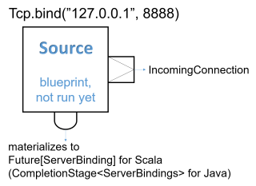
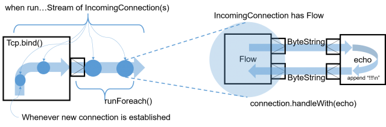

# Working with streaming IO

## Dependency

To use Pekko Streams, add the module to your project:

@@dependency[sbt,Maven,Gradle] {
  bomGroup=org.apache.pekko bomArtifact=pekko-bom_$scala.binary.version$ bomVersionSymbols=PekkoVersion
  symbol1=PekkoVersion
  value1="$pekko.version$"
  group="org.apache.pekko"
  artifact="pekko-stream_$scala.binary.version$"
  version=PekkoVersion
}

## Introduction

Pekko Streams provides a way of handling File IO and TCP connections with Streams.
While the general approach is very similar to the @ref:[Actor based TCP handling](../io-tcp.md) using Pekko IO,
by using Pekko Streams you are freed of having to manually react to back-pressure signals,
as the library does it transparently for you.

## Streaming TCP

### Accepting connections: Echo Server

In order to implement a simple EchoServer we `bind` to a given address, which returns a @scala[@apidoc[stream.*.Source]\[@apidoc[IncomingConnection](stream.*.Tcp.IncomingConnection), @scaladoc[Future](scala.concurrent.Future)\[@apidoc[ServerBinding](stream.*.Tcp.ServerBinding)\]]@java[@apidoc[stream.*.Source]<@apidoc[IncomingConnection](stream.*.Tcp.IncomingConnection), @javadoc[CompletionStage](java.util.concurrent.CompletionStage)<@apidoc[ServerBinding](stream.*.Tcp.ServerBinding)>>],
which will emit an `IncomingConnection` element for each new connection that the Server should handle:

Scala
:   @@snip [StreamTcpDocSpec.scala](/docs/src/test/scala/docs/stream/io/StreamTcpDocSpec.scala) { #echo-server-simple-bind }

Java
:   @@snip [StreamTcpDocTest.java](/docs/src/test/java/jdocs/stream/io/StreamTcpDocTest.java) { #echo-server-simple-bind }



Next, we handle *each* incoming connection using a @apidoc[stream.*.Flow] which will be used as the operator
to handle and emit @apidoc[util.ByteString] s from and to the TCP Socket. Since one `ByteString` does not have to necessarily
correspond to exactly one line of text (the client might be sending the line in chunks) we use the @apidoc[Framing.delimiter](stream.*.Framing$) {scala="#delimiter(delimiter:org.apache.pekko.util.ByteString,maximumFrameLength:Int,allowTruncation:Boolean):org.apache.pekko.stream.scaladsl.Flow[org.apache.pekko.util.ByteString,org.apache.pekko.util.ByteString,org.apache.pekko.NotUsed]" java="#delimiter(org.apache.pekko.util.ByteString,int,org.apache.pekko.stream.javadsl.FramingTruncation)"}
helper Flow to chunk the inputs up into actual lines of text. The last argument controls whether an explicit line ending
is required for the last message before the connection is closed: @scala[`allowTruncation = true` means that the last message
is emitted even without a trailing line ending]@java[`FramingTruncation.DISALLOW` means that an explicit line ending is required
even for the last message].
In this example we add exclamation marks to each incoming text message and push it through the flow:

Scala
:   @@snip [StreamTcpDocSpec.scala](/docs/src/test/scala/docs/stream/io/StreamTcpDocSpec.scala) { #echo-server-simple-handle }

Java
:   @@snip [StreamTcpDocTest.java](/docs/src/test/java/jdocs/stream/io/StreamTcpDocTest.java) { #echo-server-simple-handle }



Notice that while most building blocks in Pekko Streams are reusable and freely shareable, this is *not* the case for the
incoming connection Flow, since it directly corresponds to an existing, already accepted connection its handling can
only ever be materialized *once*.

Closing connections is possible by cancelling the *incoming connection* @apidoc[stream.*.Flow] from your server logic (e.g. by
connecting its downstream to a @apidoc[Sink.cancelled](stream.*.Sink$) {scala="#cancelled[T]:org.apache.pekko.stream.scaladsl.Sink[T,org.apache.pekko.NotUsed]" java="#cancelled()"} and its upstream to a @apidoc[Source.empty](stream.*.Source$) {scala="#empty[T]:org.apache.pekko.stream.scaladsl.Source[T,org.apache.pekko.NotUsed]" java="#empty()"}.
It is also possible to shut down the server's socket by cancelling the @apidoc[IncomingConnection](stream.*.Tcp.IncomingConnection) source `connections`.

We can then test the TCP server by sending data to the TCP Socket using `netcat`:

```
$ echo -n "Hello World" | netcat 127.0.0.1 8888
Hello World!!!
```

### Connecting: REPL Client

In this example we implement a rather naive Read Evaluate Print Loop client over TCP.
Let's say we know a server has exposed a simple command line interface over TCP,
and would like to interact with it using Pekko Streams over TCP. To open an outgoing connection socket we use
the `outgoingConnection` method:

Scala
:   @@snip [StreamTcpDocSpec.scala](/docs/src/test/scala/docs/stream/io/StreamTcpDocSpec.scala) { #repl-client }

Java
:   @@snip [StreamTcpDocTest.java](/docs/src/test/java/jdocs/stream/io/StreamTcpDocTest.java) { #repl-client }

The `repl` flow we use to handle the server interaction first prints the servers response, then awaits on input from
the command line (this blocking call is used here for the sake of simplicity) and converts it to a
@apidoc[util.ByteString] which is then sent over the wire to the server. Then we connect the TCP pipeline to this
operator–at this point it will be materialized and start processing data once the server responds with
an *initial message*.

A resilient REPL client would be more sophisticated than this, for example it should split out the input reading into
a separate mapAsync step and have a way to let the server write more data than one ByteString chunk at any given time,
these improvements however are left as exercise for the reader.

### Avoiding deadlocks and liveness issues in back-pressured cycles

When writing such end-to-end back-pressured systems you may sometimes end up in a situation of a loop,
in which *either side is waiting for the other one to start the conversation*. One does not need to look far
to find examples of such back-pressure loops. In the two examples shown previously, we always assumed that the side we
are connecting to would start the conversation, which effectively means both sides are back-pressured and can not get
the conversation started. There are multiple ways of dealing with this which are explained in depth in @ref:[Graph cycles, liveness and deadlocks](stream-graphs.md#graph-cycles),
however in client-server scenarios it is often the simplest to make either side send an initial message.

@@@ note

In case of back-pressured cycles (which can occur even between different systems) sometimes you have to decide
which of the sides has to start the conversation in order to kick it off. This can be often done by injecting an
initial message from one of the sides–a conversation starter.

@@@

To break this back-pressure cycle we need to inject some initial message, a "conversation starter".
First, we need to decide which side of the connection should remain passive and which active.
Thankfully in most situations finding the right spot to start the conversation is rather simple, as it often is inherent
to the protocol we are trying to implement using Streams. In chat-like applications, which our examples resemble,
it makes sense to make the Server initiate the conversation by emitting a "hello" message:

Scala
:   @@snip [StreamTcpDocSpec.scala](/docs/src/test/scala/docs/stream/io/StreamTcpDocSpec.scala) { #welcome-banner-chat-server }

Java
:   @@snip [StreamTcpDocTest.java](/docs/src/test/java/jdocs/stream/io/StreamTcpDocTest.java) { #welcome-banner-chat-server }

To emit the initial message we merge a @apidoc[stream.*.Source] with a single element, after the command processing but before the
framing and transformation to @apidoc[util.ByteString] s this way we do not have to repeat such logic.

In this example both client and server may need to close the stream based on a parsed command - `BYE` in the case
of the server, and `q` in the case of the client. This is implemented by @scala[taking from the stream until `q`
and concatenating a `Source` with a single `BYE` element which will then be sent after the original source completed]@java[using a custom operator extending @ref[`GraphStage`](stream-customize.md)
which completes the stream once it encounters such command].

### Using framing in your protocol

Streaming transport protocols like TCP only pass streams of bytes, and does not know what is a logical chunk of bytes from the
application's point of view. Often when implementing network protocols you will want to introduce your own framing.
This can be done in two ways:
An end-of-frame marker, e.g. end line `\n`, can do framing via @apidoc[Framing.delimiter](stream.*.Framing$) {scala="#delimiter(delimiter:org.apache.pekko.util.ByteString,maximumFrameLength:Int,allowTruncation:Boolean):org.apache.pekko.stream.scaladsl.Flow[org.apache.pekko.util.ByteString,org.apache.pekko.util.ByteString,org.apache.pekko.NotUsed]" java="#delimiter(org.apache.pekko.util.ByteString,int,org.apache.pekko.stream.javadsl.FramingTruncation)"}.
Or a length-field can be used to build a framing protocol.
There is a bidi implementing this protocol provided by @apidoc[Framing.simpleFramingProtocol](stream.*.Framing$) {scala="#simpleFramingProtocol(maximumMessageLength:Int):org.apache.pekko.stream.scaladsl.BidiFlow[org.apache.pekko.util.ByteString,org.apache.pekko.util.ByteString,org.apache.pekko.util.ByteString,org.apache.pekko.util.ByteString,org.apache.pekko.NotUsed]" java="#simpleFramingProtocol(int)"}.

@scala[@scaladoc[JsonFraming](pekko.stream.scaladsl.JsonFraming$#objectScanner(maximumObjectLength:Int):org.apache.pekko.stream.scaladsl.Flow[org.apache.pekko.util.ByteString,org.apache.pekko.util.ByteString,org.apache.pekko.NotUsed])]@java[@javadoc[JsonFraming](pekko.stream.javadsl.JsonFraming#objectScanner(int))] separates valid JSON objects from incoming @apidoc[util.ByteString] objects:

Scala
:  @@snip [JsonFramingSpec.scala](/stream-tests/src/test/scala/org/apache/pekko/stream/scaladsl/JsonFramingSpec.scala) { #using-json-framing }

Java
:  @@snip [JsonFramingTest.java](/stream-tests/src/test/java/org/apache/pekko/stream/javadsl/JsonFramingTest.java) { #using-json-framing }

### TLS

Similar factories as shown above for raw TCP but where the data is encrypted using TLS are available from `Tcp`
through `outgoingConnectionWithTls`, `bindWithTls` and `bindAndHandleWithTls`,
see the @scala[@scaladoc[`Tcp Scaladoc`](pekko.stream.scaladsl.Tcp)]@java[@javadoc[`Tcp Javadoc`](pekko.stream.javadsl.Tcp)]  for details.

When using `pekko.stream.materializer.tls.engine = graph-stage`, TLS packet buffers are sized to
the requirements of the `SSLEngine`. The `pekko.io.tcp.direct-buffer-size` setting controls the
size of reusable TCP buffers; it does not limit the TLS record size. If a TLS buffer needs more
space than the TCP pool provides, the TLS stage uses heap buffers for that connection, initially
sharing one allocation between its three transport buffers. Packet buffers grow if session requirements
increase, preserving pending ciphertext. After a handshake reduces the required output capacity, the
stage shrinks its output buffer once pending ciphertext has been sent, returning to a pooled buffer
when it fits. A capacity required by an empty-buffer overflow is retained until the next handshake
to avoid repeated allocation. Heap fallback buffers are never returned to the shared TCP pool.
Small transport buffers can restrict plaintext
batches to one TLS record per engine call; batch limits are recalculated from the actual output
capacity as it grows. Measure allocation and throughput for your workload before tuning this setting.

Using TLS requires a keystore and a truststore and then a somewhat involved dance of configuring the SSLEngine and the details for how the session should be negotiated:

Scala
:  @@snip [TcpSpec.scala](/stream-tests/src/test/scala/org/apache/pekko/stream/io/TcpSpec.scala) { #setting-up-ssl-engine }

Java
:  @@snip [TcpTest.java](/stream-tests/src/test/java/org/apache/pekko/stream/javadsl/TcpTest.java) { #setting-up-ssl-engine }


The `SSLEngine` instance can then be used with the binding or outgoing connection factory methods.

The GraphStage TLS engine keeps an asynchronous boundary around TLS processing. It sends element
messages across that boundary without sender-side batching, preserving their order relative to a
later plaintext-output cancellation from the same handler. This orders boundary messages; it does
not drain elements still buffered in other operators or change TLS closing policies.

### TLS closing policies

The `closing` parameter of @apidoc[TLS](stream.*.TLS$) controls how plaintext-input completion
and plaintext-output cancellation close the connection; see @apidoc[TLSClosing](stream.TLSClosing).
When cancellation closes the connection, bytes not yet accepted by the operator may be discarded.
With `pekko.stream.materializer.tls.engine = graph-stage`, the operator stops further plaintext input
and attempts to send data already accepted for the established session, subject to transport
availability. This includes up to 64 queued messages plus plaintext already buffered for wrapping.
Message sizes are unbounded, so termination can be delayed until that data is sent. Data queued after
a renegotiation request is discarded, and draining stops if a new handshake is required. A TLS 1.3
post-handshake message such as a KeyUpdate is not a new handshake, so the response is sent and draining
continues; in TLS 1.2 any further handshake stops the drain. Cancellation
during a handshake or a transport failure can still prevent delivery. The default `legacy-actor`
engine discards accepted plaintext on cancellation. Use the `IgnoreCancel` closing policy
(`TLSClosing.ignoreCancel()` in Java) if the handler needs to continue producing a response after it
stops reading.

The GraphStage drain also applies when plaintext-output cancellation is observed before the peer's
transport input completes. If transport-input completion is observed first, the existing inbound-close
contract applies and accepted plaintext is discarded, matching the legacy actor engine.
The drain also continues after a TLS 1.3 peer sends `close_notify`, because that only closes the
peer's sending direction. A TLS 1.2 `close_notify` closes both directions of the `SSLEngine`, so it
ends the drain and accepted plaintext that has not been sent is discarded.

Unless a clean shutdown is already waiting for the peer's reply, cancelling the transport output
ends the session, because nothing more can be sent to the peer. That
teardown is not silent: once the session is established, the operator still delivers the inbound
data it can decrypt in the round that observes the cancellation, and then reports
`SessionTruncated` before the plaintext output completes if the peer's `close_notify` has not been
processed. This also applies with no buffered inbound records and during renegotiation of an
established session: truncation means that a clean peer shutdown was not observed, rather than proof
that application bytes were lost. Inbound records still buffered beyond that round are discarded.
The operator does not wait for more ciphertext to complete a partial TLS record: cancellation can
discard fragments still in flight, and the truncation signal makes that abandonment observable.
An already pending plaintext element is delivered before the signal. A plaintext output that is
already closed, or a session cancelled before its initial handshake finished, completes without that
signal. The transport-output cancellation itself does not call `SSLEngine.closeInbound()` or
invalidate the established `SSLSession`. If transport input has already completed and is depleted,
the cancellation path skips the final inbound round and reports truncation directly.

If the operator has already sent its own `close_notify` and is waiting for the peer's reply,
transport-output cancellation preserves that existing wait while the plaintext output is open.
Cancelling the plaintext output as well ends the wait. An operator still flushing outbound data
cannot continue sending after transport-output cancellation.

The truncation signal obeys plaintext backpressure. The plaintext input is cancelled immediately
when the transport output is cancelled, even if the final inbound round is waiting for plaintext
demand. The transport input is cancelled after that round; the operator then stays alive until
the signal is consumed or the plaintext output is cancelled.
Applications that stop reading must cancel that output as well; applications requiring a time bound
can apply `completionTimeout` to the plaintext stream. Consumers using the TLS `BidiFlow` directly
must handle `SessionTruncated` explicitly rather than using a partial `map` that only matches
`SessionBytes`. The Scala and Java `Tcp.bindWithTls` and `Tcp.outgoingConnectionWithTls` APIs expose
`ByteString` streams and filter out this signal.

## Streaming File IO

Pekko Streams provide simple Sources and Sinks that can work with @apidoc[util.ByteString] instances to perform IO operations
on files.

Streaming data from a file is as easy as creating a *FileIO.fromPath* given a target path, and an optional
`chunkSize` which determines the buffer size determined as one "element" in such stream:

Scala
:   @@snip [StreamFileDocSpec.scala](/docs/src/test/scala/docs/stream/io/StreamFileDocSpec.scala) { #file-source }

Java
:   @@snip [StreamFileDocTest.java](/docs/src/test/java/jdocs/stream/io/StreamFileDocTest.java) { #file-source } 

Please note that these operators are backed by Actors and by default are configured to run on a pre-configured
threadpool-backed dispatcher dedicated for File IO. This is very important as it isolates the blocking file IO operations from the rest
of the ActorSystem allowing each dispatcher to be utilised in the most efficient way. If you want to configure a custom
dispatcher for file IO operations globally, you can do so by changing the `pekko.stream.materializer.blocking-io-dispatcher`,
or for a specific operator by specifying a custom Dispatcher in code, like this:

Scala
:   @@snip [StreamFileDocSpec.scala](/docs/src/test/scala/docs/stream/io/StreamFileDocSpec.scala) { #custom-dispatcher-code }

Java
:   @@snip [StreamFileDocTest.java](/docs/src/test/java/jdocs/stream/io/StreamFileDocTest.java) { #custom-dispatcher-code }
